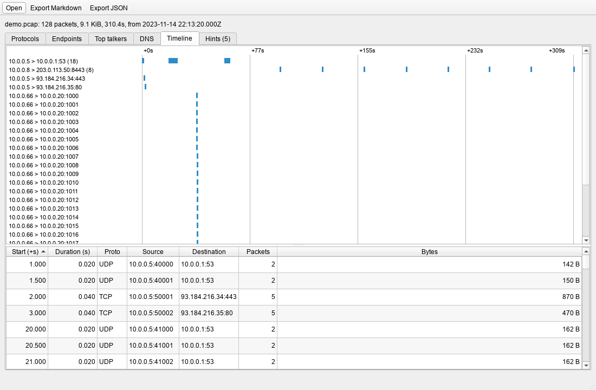
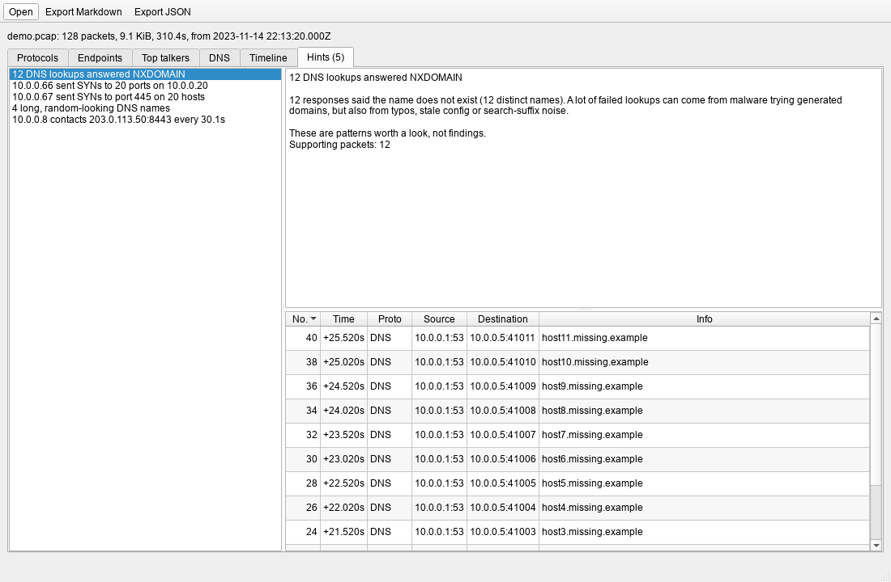

# PCAP Detective

Small tool for looking through a pcap or pcapng file after the fact. It gives you protocol counts,
endpoints and top talkers, DNS queries, a connection timeline, and a few hints about patterns that
might deserve a closer look. There's a PySide6 GUI and a CLI, and the summary exports to Markdown
or JSON.




The screenshots are made from a synthetic capture by `scripts/make_screenshot.py`.

It only reads files. No sniffing, no sending anything.

## Install

Windows, Python 3.10+ (I use 3.14; CI runs 3.12):

```bat
git clone <this repo> pcap-detective
cd pcap-detective
python -m venv .venv
.venv\Scripts\activate
python -m pip install -e ".[dev]"
```

## Usage

GUI: drop a file on the window or press Ctrl+O.

```bat
python -m pcap_detective
python -m pcap_detective some.pcap
```

CLI:

```bat
pcap-detective some.pcap
pcap-detective some.pcapng --format markdown -o summary.md
pcap-detective some.pcap --format json -o summary.json --db packets.db
```

`-o` and `--db` won't overwrite an existing file unless you pass `--force`, and neither will touch
the input file. Exit code is 0 on success, 2 if the file can't be read (message on stderr).
`--db` keeps the parsed packets in a SQLite file (table `packets`) if you want to query them
yourself.

## The hints

Each one comes with a short explanation and the packet numbers behind it (the numbers match
Wireshark's "No." column). They're hints, not verdicts: every one of these has innocent causes,
and the explanations say so.

- **NXDOMAIN burst**: 10 or more DNS answers saying the name doesn't exist.
- **Port scan / host sweep**: one source sending bare SYNs to 15+ ports on one host, or to one
  port on 15+ hosts.
- **Random-looking DNS names**: 3+ queried names with a label of 20+ characters and Shannon
  entropy of 3.5 bits per character or more.
- **Beaconing-like**: 6+ separate connections from one host to the same destination and port,
  starting at a regular interval (at least 1s apart on average, spread under 15%).

The thresholds are constants at the top of `pcap_detective/flags.py`.

## Development

```bat
python -m pytest -q
ruff check .
ruff format --check .
```

All test captures are generated with Scapy in `pcap_detective/synthetic.py`, so no real captures
are committed (`*.pcap`, `*.pcapng` are in `.gitignore`). Layout: `parser.py` turns packets into
rows, `store.py` is the SQLite side, `analysis.py` and `flags.py` build the summary, `report.py`
renders it. Qt only appears under `ui/`, and parsing runs in a worker thread.

## Limits

- Thresholds are guesses tuned on synthetic data. I haven't run this against real-world captures
  at scale, so expect false positives and misses.
- Beacon detection looks at new connections only. A single long-lived connection with periodic
  data inside it is not seen. UDP scans are not detected either.
- Protocol names come from layers and well-known ports (80/8080 is "HTTP", 443/8443 is "TLS"),
  nothing is decoded beyond DNS.
- A capture cut off exactly at a record boundary looks complete. Other cut-offs are detected
  through Scapy's log warnings, which is a bit hacky.
- Non-IP, non-ARP frames are counted as skipped. IPv6 works but is lightly tested.
- Scapy does the parsing, so big captures are slow. Rows are held in memory before they go
  to SQLite. No capture-file decompression, no reassembly, no decryption.
- Only tried on Windows. The GUI test runs offscreen, so drag and drop and file dialogs are
  untested.

## License

MIT, see [LICENSE](LICENSE).
